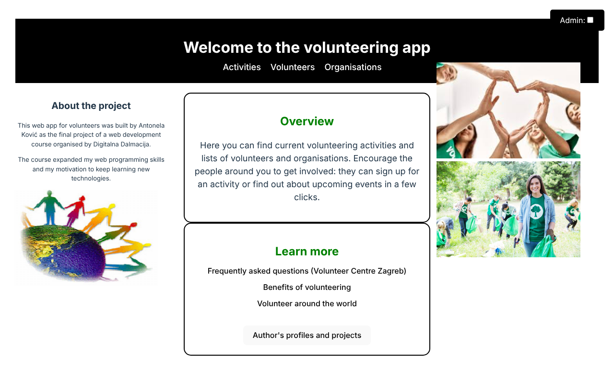
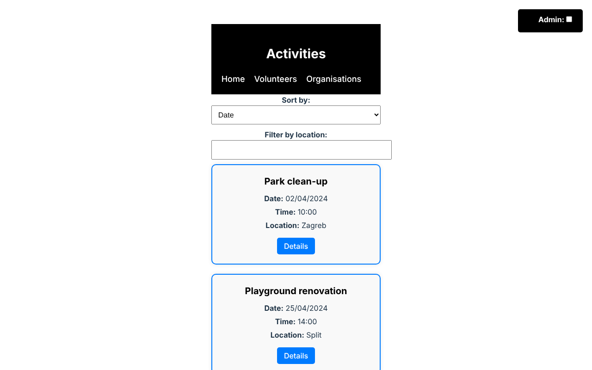
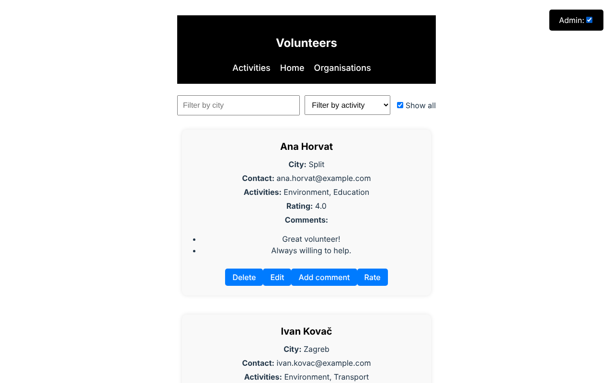
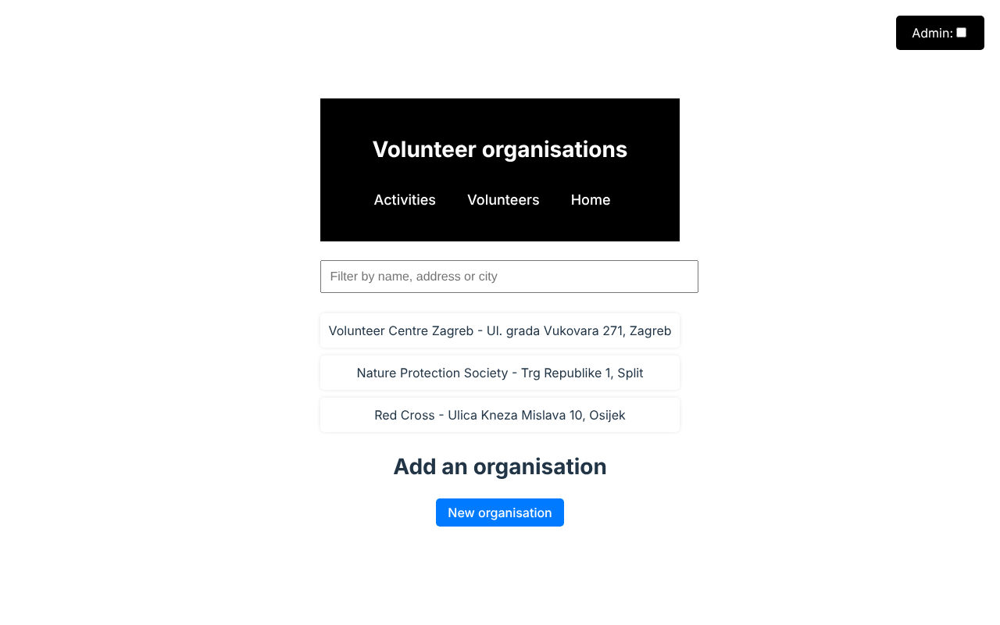

# Volunteering App (React)

A single-page React app for a volunteering platform: browse, filter and sort volunteering activities, sign participants up, manage a list of volunteers with ratings and comments, and submit new organisations for admin approval. Built as the final project of a web development course organised by Digitalna Dalmacija.

**Stack:** React 18 · React Router 6 · Context API · Vite · CSS

| Home | Activities |
|---|---|
|  |  |
| **Volunteers (admin mode)** | **Organisations** |
|  |  |

## Features

- **Activities:** activity cards with details in a modal, sorting by date or location, filtering by location, adding participants, adding new activities, a link to the location on Google Maps.
- **Volunteers:** filtering by city and activity type, average rating, comments, adding and editing volunteers.
- **Organisations:** search by name, address or city; new organisations are sent as requests that an admin approves or rejects.
- **Admin mode:** the "Admin" checkbox simulates logging in as an administrator. The flag is shared across all pages with the React Context API (`UserContext`) and unlocks deleting and editing.

## Getting started

```bash
git clone https://github.com/antonela-kovic/volunteering-app-react.git
cd volunteering-app-react
npm install
npm run dev        # http://localhost:5173
```

Other scripts: `npm run build` (production build into `dist/`), `npm run preview`, `npm run lint`.

## Project structure

```
src/
├── main.jsx            # entry point
├── App.jsx             # routes and the UserProvider
├── UserContext.jsx     # admin flag shared through React Context
├── Home.jsx            # landing page
├── ActivityList.jsx    # activities, participants, new activity form
├── VolunteerList.jsx   # volunteers, ratings, comments, add/edit form
├── Organizations.jsx   # organisations and approval requests
└── *.css               # styles per page
public/images/          # images used on the home page
```

## Notes and possible improvements

- All data lives in component state, so changes are lost on page reload. A REST backend or `localStorage` would make them persistent.
- The admin mode is a UI toggle for demonstration, not authentication.
- The sample people and email addresses are fictional.

## Author

Antonela Ković – [GitHub](https://github.com/antonela-kovic)
